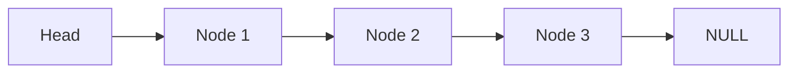
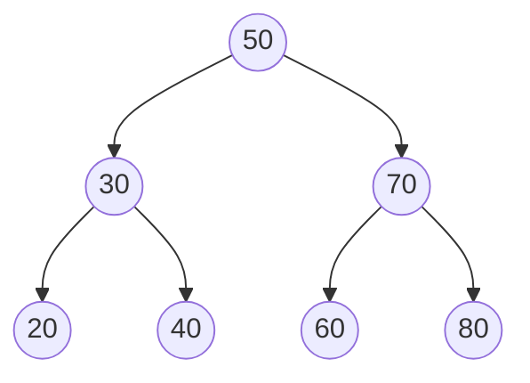

# Data Structures

## Elementary Data Types
- Boolean (True/False - Non Zero / Zero - 1 Bit)
- Byte / Character (8 Bit, Char *C/C++)
- Short (16 Bit)
- Character (16 Bit *Java)
- Wide Char (16 Bit, wchar_t C/C++)
- Integer (32 Bit)
- Long (64 Bit)
- Float (32 Bit)
    - Compound type
    - Sign (1 Bit)
    - Exponent (8 Bit)
    - Mantisse (23 Bit -> 24 Bit for precision)
- Double (64 Bit)
    - Compound type
    - Sign (1 Bit)
    - Exponent (11 Bit)
    - Mantisse (52 Bit)
- Reference

## Compound Data Types

- Structures
- Record
- Dataset
- Class / Object

These extended data sets are represented as references in most PL (Java), some can store the element itself (C/C++)

## Array

- fundamental data type (built in in most PL)
- aka field, vector
- must be one of the above data types
- need to be acquired of memory storage (at compile time = static, at runtime = dynamic)
- basic operations
    - read / get (using numerical index)
    - write / set
    - create (**new**)
    - dispose / destroy (**delete**)
- in most PL zero based

## (Array) List

- Collection of ordered data
- typically dynamic (not of fixed size)
- sometime internally realized as an array, but reveales the reference
- basic operations
    - write / set (add, append, insert)
    - read / get (index like an array [])
    - delete / remove
    - clear
    - size / length
    - isEmpty
    - extend / shrink (sometimes not accessable)
        - typically doubling the capacity
        - sometimes with thresholds for +100%, +50%, ...
- advanced operations (algorithm section)
    - contains / search / find
    - sort
    - iterator
    - map / filter / forEach

## Linked List

- saving element with the information of its successor
- Node
    ```mermaid
        block-beta
            block
                Reference_to_next_element
                The_data_element
            end
    ```
- if there is no next element, then NIL/NULL is set
- we nee a reference to the first element (HEAD, ROOT)
- basic operations
    - write / set (add, append, insert)
        - create a new node
        - find last element and set next reference to current element
        - maybe store last element to speed up
        - insert at the beginning is very fast
    - read / get (index like an array [])
        - accessing by index we need to iterate by counting the elements
    - delete / remove
        - we need the element first, see read
        - removing just need to rewire the next reference
    - clear
        - clean up all nodes
    - size / length
    - isEmpty

Example


Comparison Array (List) and Linked (List)
| Operation | Array | Linked List |
|-|-|-|
| create (insert) | slow O(n) | fast O(1) |
| read | fast O(1) | slow O(n) |
| update | fast | slow |
| delete | slow | fast |
| Memory | just the data | extra reference needed |

## Double Linked List

- Node
    ```mermaid
    block-beta
            block
                Reference_to_next_element
                Reference_to_previous_element
                The_data_element
            end
    ```
- typically there are references to the first element (head, first), and last element (tail, last)
- easy of iterating from to front to last, and last to front
- also easy in deleting an element in the middle

### XOR Double Linked List

- Node
    ```mermaid
        block-beta
            block
                XOR_Reference_to_next/previous_element
                The_data_element
            end
    ```
- Storing an element means, XORing the previous and next reference as our XOR reference
- Getting the next element, XORing the previous reference
- Getting the previous element, XORing the next reference
- But not possible to get next or previous of a random element
- see [Wikipedia](https://en.wikipedia.org/wiki/XOR_linked_list)

## Set

| List | Set |
|-|-|
| ordered elements | unordered elements |
| double elements allowed | no double elements allowed |

- typically implemented as an arry or linked list

## Table (Map, Dictionary, Key/Value-Pairs)

- behaves like an array, but with an alphanumeric index, e.g. table['red']
- realization
    - two corresponding arrays, one for the keys, other the values
    - maybe, one array storing a node: key, value
        ```mermaid
            block-beta
                block
                    key_element
                    data_element
                end
        ```
    - keep this array sorted (SortedMap)
    - excursion:
        - linear search: O(n)
        - binary search: O(log_2 n)
        - hashing : O(1)
    - using hashing (HashMap)
        - converting a string (sequence of elements) into a number, e.g. ((('r' * 100) + 'e') * 100) + 'd'
        - using this number as the numerical index for a standard array
        - any hash function will return an integer (31 Bit)
        - this value will be truncated (modulo %) by the size of the designated array
        - truncating will lead to collision (different keys with the same number)
        - solutions
            - use the next free number (worse utilization of array space)
            - recalculating the array position
            - using a linked list on the index position
            (better utilization of array space)
        - array might get full
            - new bigger array must be allocated, the truncation value will be adopted and all old values/keys must be recalculated
            - often already extended by an utilization of 70%

Comparison Sorted Table and Hashed Table
| | SortedMap | HashMap |
|-|-|-|
| Implementation | dynamic array | fixed (truncated) array |
| Insert Operation | Insertion sort | Hash calculation |
| if full | array extended | new array with hash recalculation |
| Read | Binary Search | Indexed accees with linear search |
| Delete | a bit slow | a bit faster |

## Stack and Queue

- Operations
    - add data (push / put)
    - read data (pop / get) - element will be removed
    - status information (empty / full)
    - read information w/o deleting (peek)
- Stack
    - Last In First Out (LIFO)
    - Latest element stored will be retrieved first
- Queue
    - First In First Out (FIFO / FCFS)
    - First element stored will be retrieved first
- Implementation
    - e.g. Array or Linked List
    - typically Array for Stack, Linked List for Queue

## Tree

### Binary (Search) Tree

- Node with two successors
- Node
    ```mermaid
    block-beta
            block
                The_data_element
                Reference_to_left_node
                Reference_to_right_node
            end
    ```
- Typically sorted, left refers to elements of lesser value as the data element, right refers to elements of higher value as the data element
- e.g.

- Operations
    - create/insert
        - the tree should be kept in balance (number of element of each side should approximately even)
    - read
        - search like doing a binary search
    - delete
        - like insert, the tree should be kept in balance
    - update
        - clould also lead to re-balancing the tree
        - delete and insert
    - traverse
        - Inorder (left - print - right)
        - Preorder (print - left - right)
        - Postorder (left - right - print)
        - right - print - left
        - (print - right - left)
- Terminology
    - Parent Node (e.g. 50 is parent for 30 and 70)
    - Child Node (e.g. 30 is child for 50)
    - Ancestor of a node (All nodes on the path of the root to that specific node)
    - Descendants of a node (All nodes that lie in the subtree of that node as a root)
    - Root Node (e.g. 50 is the root, where the tree starts)
    - Leaf Node (Nodes without childrend)
    - Internal Nodes (Nodes with at least one child)
    - Subtree of a node (A tree consisting of that node and all its descendants)
    - Path in a tree (A sequence of nodes from the root to this node)
    - Edge (The link between a parent node and its child node)
    - Depth/Level of a Node (Number of edges in the path to that node)
    - Height (Number of nodes of the longest path in a tree)

### AVL Tree

- Adelson-Velsky, and Landis
- self-balanced binary search tree

### Red-Black Tree

- self-balanced binary search tree
- additional color attribute to each node

### Ternary Search Tree

- each node has three children (e.g. left for lower, middle for same, and right for higher)

### n-ary Tree (Generic Tree)

- each node can have any number of children

### B Tree

- specialized n-ary tree with balanced subtrees

### B+ Tree

- an extended version of the B Tree
- optimized for disk/cache access

## Graph

- Nodes and Endges
    - Graph G = <N, E>
     N = Set of Nodes
     E = Set of Edges (Set of Node pairs)
    - Digraph (Directed Graph) G = <N, E>
    - Weigthed Graph G = <N, E, F>
    F = Function returning the weight of a node pair
- Any number of nodes, and any possible connection between two nodes
- Storage requirements
    - List of Nodes (Array List)
    - Edges per Node (Array List of Edges / Reference to the other node)
- Realization
    - Node List
        - e.g. <\#N, \#E, a1, a2, b1, b2, ...>
        - (a1, a2) representing the edge, with a1 as the start node, a2 as the end node
        - applyable to a graph and digraph
        - e.g. Graph G = <4, 4, 0, 2, 1, 2, 1, 3, 2, 3>
        - e.g. Digraph G = <4, 4, 0, 1, 0, 2, 1, 2, 3, 2>


# Algorithms

## Properties of Algorithms

- Determination
- Determinism
- Termination
- Efficiency

